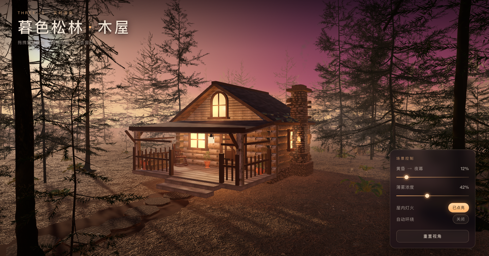
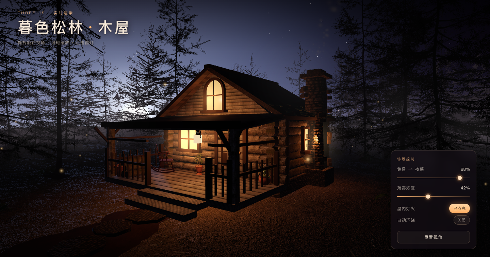
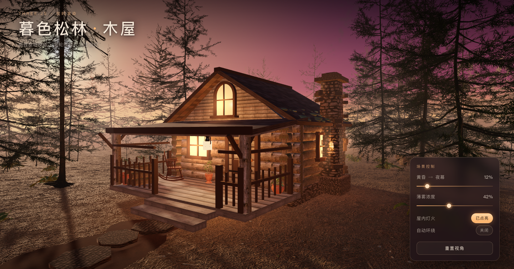
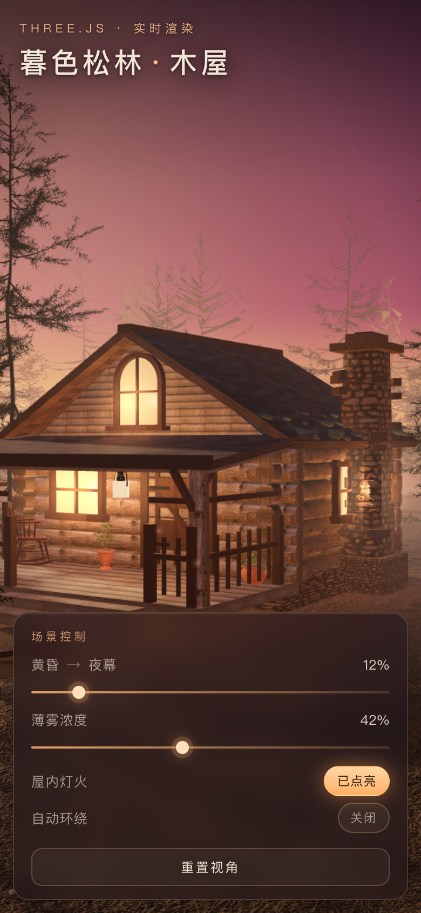

# 暮色松林 · 木屋（写实素材版）

用 **Vite + Three.js** 打造的交互式林间小屋场景。第二版把程序化的圆锥树换成了
**Poly Haven 的 CC0 写实杉木 / 松树 / 苔藓 / 岩石 / 枯木模型**，并补上了 PBR 地表与木屋材质。

- 近处是 18.9 m 的成熟杉木，枝条从画面两侧压进来
- 木屋被 4 级 LOD 的杉木林层层包围，雾里还有更远的天际线剪影
- 黄昏到夜晚连续过渡，窗灯、门廊灯、萤火虫、炊烟都保留



## 环境

| 项目 | 版本 |
| --- | --- |
| macOS | 27.0.1（Apple Silicon） |
| Node.js | v22.22.3 |
| npm | 10.9.8 |
| three | 0.187.0 |
| vite | 8.3.8 |

运行时依赖仍然只有 `three`，没有引入任何第三方渲染插件或后处理库。

## 启动

```bash
npm install
npm run dev      # http://localhost:5173
```

```bash
npm run build     # 生产构建
npm run preview   # 预览构建产物
```

## 交互

- **拖拽**：环绕木屋旋转（带阻尼），**滚轮 / 双指**：缩放
- **点击窗户**：开关屋内灯火，灯光渐亮渐暗
- **黄昏 → 夜幕**：太阳角度、三段式天空、雾色、曝光、星空一起插值
- **薄雾浓度**：全局指数雾 + 贴地雾团联动
- **自动环绕**、**重置视角**
- 竖屏自动拉远机位、放宽视场

## 木屋细节升级

参考“写实森林小屋”的方向，木屋在程序化几何上做了大幅细化：

- **石砌烟囱**：锥形砌体 + 扫描石纹 + 34 块凸出毛石 + 石帽，贴墙而立
- **门廊**：加深甲板、三面木栏杆（栏杆柱 + 端柱）、斜撑、檐梁与木板顶棚
- **山墙拱窗**：拱形玻璃 + 木框 + 十字窗棂 + 窗台，暖光透出
- **门**：双凹板、铁艺合页、黄铜把手、门框
- **屋顶**：檐口与屋脊的青苔簇（深绿、贴瓦面）
- **门廊陈设**：Poly Haven 摇椅、陶盆、两株盆栽、吊灯（带发光灯芯与光晕）
- **柴堆**：门廊左侧堆放的圆木，断面用独立浅色木纹材质
- **土径**：从台阶蜿蜒向前的泥土路面，与踏石、蕨类一起形成入户小径

同时把整体色调调成“冷蓝雾气 + 暖金灯火”，更接近参考图的氛围。

## 素材来源与授权

全部模型与贴图来自 **[Poly Haven](https://polyhaven.com)**，授权为 **CC0 1.0**：
可商用、可修改、无需署名，也不需要登录或绕过任何下载限制。

- 完整清单（含每个素材的原始链接）：[public/assets/models/LICENSES.md](public/assets/models/LICENSES.md)
- 运行时清单（含每个变体的高度、面数、来源）：[public/assets/models/manifest.json](public/assets/models/manifest.json)
- 贴图下载记录：[public/assets/textures/sources.json](public/assets/textures/sources.json)

| 类别 | 素材 |
| --- | --- |
| 树木 | Fir Tree 01、Fir Sapling Medium、Pine Sapling Small、Fir Sapling |
| 林下 | Moss 01、Rock Moss Set 01/02、Tree Stump 01、Dead Tree Trunk 01/02、Fern 02、Grass Medium 01、Shrub 01/02、Dry Branches、Pine Roots |
| 门廊陈设 | Rockingchair 01、Lantern 01、Planter Pot Clay、Potted Plant 01/02、Boulder 01 |
| PBR 贴图 | Forest Ground 03（松针地表）、Bark Brown 02（原木）、Dark Planks（门廊/门板）、Mossy Stone Wall（石基/烟囱） |

> Poly Haven 没有木屋模型，所以小屋仍保留程序化建模，但换上了扫描的木纹、石纹贴图。
> 模型原始高模放在 `.assets-src/`（已清理，可用脚本重新下载）。

## 素材处理管线

原始素材是影视级高模（Fir Tree 01 约 **698 万面**、Fir Sapling Medium 约 **153 万面**），
不能直接进网页。项目里保留了完整的可复现脚本：

```bash
# 1. 从 Poly Haven API 下载 1k glTF（含贴图）
node scripts/download-assets.mjs fir_sapling_medium fir_tree_01 moss_01 ...

# 2. Blender 减面 + 共享贴图 + Draco 压缩（每个文件自动拆出 a/b/c 变体）
blender -b --factory-startup --python scripts/process_tree.py -- \
  --input .assets-src/fir_sapling_medium/fir_sapling_medium_1k.gltf \
  --out-dir public/assets/models/trees --prefix fir_medium --lod lodmid \
  --wood 3500 --foliage 26000 --texture 1024 --format gltf --draco 1

# 3. 扫描 glTF 生成运行时 manifest（高度 / 面数 / 来源）
node scripts/build-manifest.mjs
```

处理策略：

1. 按材质把「木质枝干」和「针叶」分开，分别设定减面预算，避免把针叶一起塌陷掉；
2. 每个 glTF 里的 a/b/c 三个树变体按空间聚类拆开、各自居中，单独导出；
3. 针叶材质从 `BLEND` 改为 **alpha test**，消除半透明排序错误，并且能正确投射阴影；
4. 树木导出为**共享贴图**的 `.gltf`，3 个变体 × 4 级 LOD 复用同一套 1k 贴图；
5. 几何体使用 **Draco** 压缩（约 5 倍），贴图按需降到 512。

最终素材体积 **65 MB**：树木几何约 15 MB、树木共享贴图约 16 MB、林下道具约 26 MB、地表与木屋贴图约 8.6 MB。

## 渲染与性能

- **InstancedMesh**：每类树、每级 LOD、每个材质一个实例化批次，约 450 棵树只有 100 多个 draw call；
- **关闭透射 pass**：提灯模型自带 `KHR_materials_transmission`，会让 Three 每帧把整个场景再渲染一遍；
  载入时把 transmission 归零后，draw call 从 970 降到 580、三角形从 2000 万降到 1100 万；
- **静态合并**：木屋的栏杆、原木、瓦片等按材质合并成少数几个 mesh，draw call 再减约 170；
- **二次减面**：对已导出的树模型再做一次塌陷减面，近景 8 万 → 2.8 万面，其余各级同步减半；
- **4 级 LOD**：近景约 2.8 万面 / 中景 1.2 万面 / 外圈 5 千面 / 远景 2.2 千面，按距离分配；
  只有 14 m 内的树用最高 LOD，其余立刻降档；
- **扇区剔除**：远景按方位角切成 4 个扇区，视锥剔除能真正生效；
- **阴影收敛**：只有近景树、框景树和木屋主体投影，栏杆/窗户/盆栽/苔藓等小件不投影，阴影贴图 1024²；
- **共享贴图 + Draco**：GLTFLoader 复用纹理，DRACOLoader 解码压缩几何；
- **PBR 环境光**：用天空 shader 实时生成 PMREM 环境贴图，树木和木屋有正确的环境色；
- 默认视角约 **590 万三角形 / 364 draw call**（含阴影 pass），像素比上限 1.5；
比起上一版（1130 万 / 580）负担减半，画面几乎看不出差别。

材质细节：针叶使用双面 + alpha test，靠 MSAA 抗锯齿；树干、岩石、苔藓保留法线贴图与粗糙度
贴图，避免“塑料感”。

## 目录结构

```
dusk-pine-cabin/
├── index.html / src/main.js          # 页面、渲染循环、相机、昼夜、交互
├── src/world/
│   ├── models.js                     # GLTF/DRACO 加载、材质修正、实例化、扇区切分
│   ├── forest.js                     # 四级 LOD 森林布局、框景树、林下植被
│   ├── cabin.js                      # 程序化木屋 + 扫描材质
│   ├── ground.js / surfaces.js       # 地形与 PBR 地表
│   ├── sky.js / mist.js              # 黄昏天空、星空、薄雾、萤火虫
│   └── terrain.js                    # 共享高度场
├── public/
│   ├── assets/models/                # 树木 / 道具 glTF、manifest.json、LICENSES.md
│   ├── assets/textures/              # 1k PBR 贴图与下载记录
│   └── draco/                        # three 自带 Draco 解码器
├── scripts/                          # 下载 / 减面 / manifest / 截图与回归脚本
└── preview/                          # 场景截图
```

## 预览

| 黄昏 | 夜晚 |
| --- | --- |
|  |  |





## 说明

- `scripts/capture.mjs`、`scripts/test-scene.mjs` 只用于本机无头 Chrome 截图与回归，
  需要以 `--remote-debugging-port=9223` 启动浏览器，不参与构建。
- 若在受限沙箱里 `npm install` 遇到 `~/.npm` 无写权限，可加 `--cache ./.npm-cache`。
